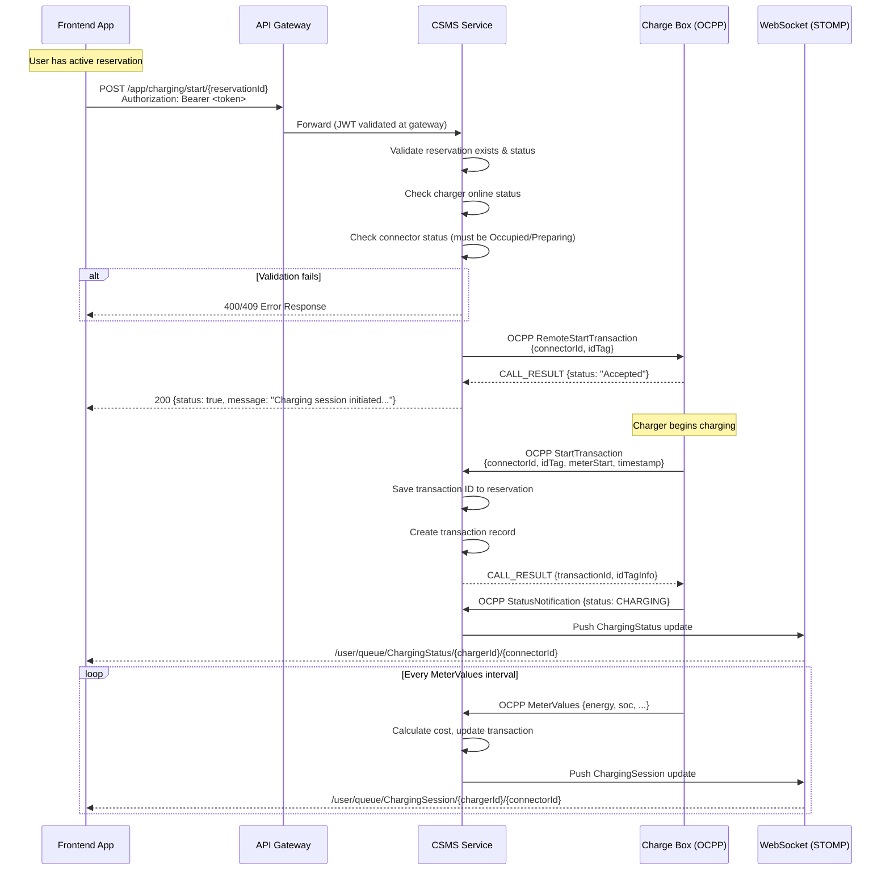
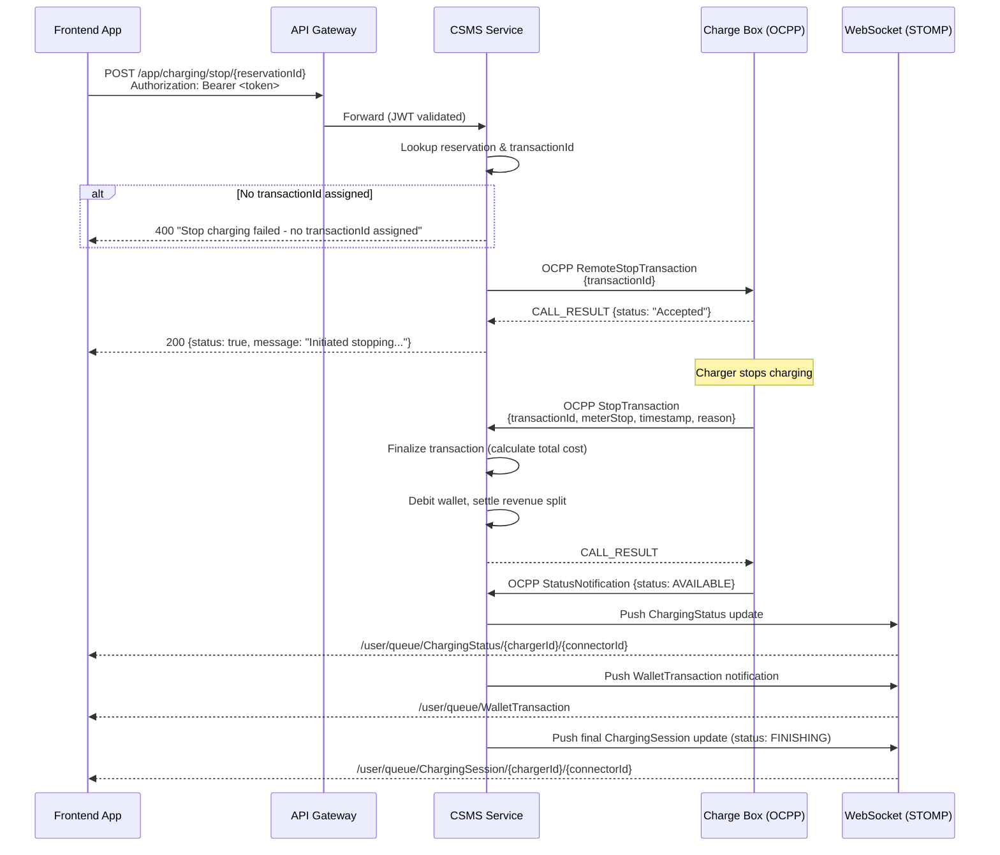
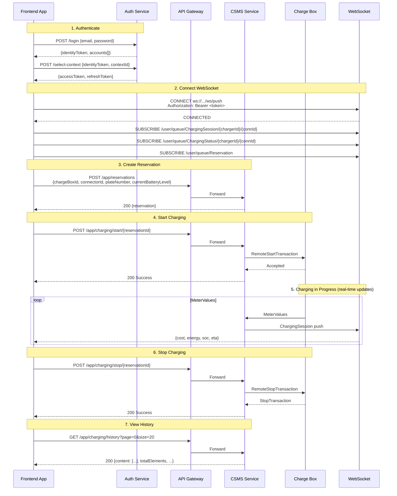
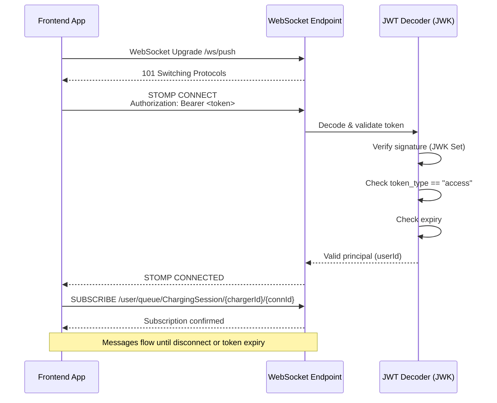

# Charging Session Handling — Frontend Integration Guide

> **Audience**: Frontend developers (Vanilla JS, React Native, Flutter)
> **Protocol**: REST (JSON) + STOMP over WebSocket
> **Auth**: Bearer JWT (OAuth2 Resource Server)

---

## Table of Contents

1. [Authentication](#1-authentication)
2. [Start Charging Session](#2-start-charging-session)
3. [Stop Charging Session](#3-stop-charging-session)
4. [Charging Transaction History](#4-charging-transaction-history)
5. [Real-Time Push Notifications (STOMP WebSocket)](#5-real-time-push-notifications-stomp-websocket)
6. [Sequence Diagrams](#6-sequence-diagrams)
7. [Payload Reference](#7-payload-reference)
8. [Error Handling](#8-error-handling)

---

## 1. Authentication

All REST endpoints and the WebSocket connection require a valid **access token** obtained via the two-phase login flow.

### 1.1 Login — Phase 1

```
POST /login
Content-Type: application/json
```

**Request:**

```json
{
  "email": "user@example.com",
  "password": "s3cret"
}
```

**Response (200):**

```json
{
  "identityType": "CUSTOMER",
  "identityToken": "eyJhbGci...",
  "autoSelect": false,
  "accounts": [
    {
      "accountId": 42,
      "accountName": "My Account",
      "accountType": "CUSTOMER",
      "role": "USER"
    }
  ],
  "tokenType": "Bearer",
  "expiresIn": 300
}
```

### 1.2 Login — Phase 2 (Select Context)

```
POST /select-context
Content-Type: application/json
```

**Request:**

```json
{
  "identityToken": "eyJhbGci...",
  "contextId": 42
}
```

**Response (200):**

```json
{
  "accessToken": "eyJhbGci...",
  "refreshToken": "eyJhbGci...",
  "tokenType": "Bearer",
  "expiresIn": 3600,
  "account": {
    "accountId": 42,
    "accountName": "My Account",
    "accountType": "CUSTOMER",
    "role": "USER"
  }
}
```

### 1.3 Refresh Token

```
POST /refresh
Content-Type: application/json
```

```json
{ "refreshToken": "eyJhbGci..." }
```

Returns same shape as Phase 2 response. Access token TTL = 1 hour, refresh token TTL = 7 days.

### 1.4 Using the Token

Every authenticated request must include:

```
Authorization: Bearer <accessToken>
```

---

## 2. Start Charging Session

> **Prerequisite**: An active reservation must exist. Create one via `POST /app/reservations` first.

```
POST /app/charging/start/{reservationId}
Authorization: Bearer <accessToken>
```

| Parameter       | In   | Type | Required | Description           |
|-----------------|------|------|----------|-----------------------|
| `reservationId` | path | long | yes      | Active reservation ID |

**Success Response (200):**

```json
{
  "status": true,
  "code": 200,
  "message": "Charging session initiated successfully on SC-DC-001!",
  "data": null
}
```

**Error Responses:**

| Code | Message                                                |
|------|--------------------------------------------------------|
| 400  | `Start charging failed - Unknown reservationId {id}`   |
| 409  | `Failed to start charging! Charger {id} is offline`    |
| 409  | `Failed to start charging! - Connect vehicle`          |

After a successful call, the charger begins the OCPP handshake asynchronously. Real-time updates arrive via the **ChargingSession** WebSocket topic (see [Section 5](#5-real-time-push-notifications-stomp-websocket)).

---

## 3. Stop Charging Session

```
POST /app/charging/stop/{reservationId}
Authorization: Bearer <accessToken>
```

| Parameter       | In   | Type | Required | Description           |
|-----------------|------|------|----------|-----------------------|
| `reservationId` | path | long | yes      | Active reservation ID |

**Success Response (200):**

```json
{
  "status": true,
  "code": 200,
  "message": "Initiated stopping transaction {reservationId} successfully!",
  "data": null
}
```

**Error Responses:**

| Code | Message                                              |
|------|------------------------------------------------------|
| 400  | `Stop charging failed - no transactionId assigned`   |
| 400  | `Start charging failed - Unknown reservationId {id}` |

---

## 4. Charging Transaction History

```
GET /app/charging/history
Authorization: Bearer <accessToken>
```

| Parameter | In    | Type   | Default | Description                                          |
|-----------|-------|--------|---------|------------------------------------------------------|
| `page`    | query | int    | 0       | Zero-based page index                                |
| `size`    | query | int    | 20      | Number of records per page                           |
| `sort`    | query | string | —       | Sort field + direction (e.g. `transactionDate,desc`) |

**Response (200):**

```json
{
  "content": [
    {
      "transactionDate": "2026-05-08T10:30:00Z",
      "transactionId": 456,
      "referenceId": "TXN-20260508-001",
      "idTag": "TAG123",
      "chargeBoxId": "SC-DC-001",
      "connectorId": 1,
      "consumedUnits": 15.5,
      "totalAmount": 450.75,
      "location": "Westlands Hub",
      "stopReason": "Remote"
    }
  ],
  "pageable": {
    "pageNumber": 0,
    "pageSize": 20
  },
  "totalPages": 5,
  "totalElements": 98,
  "last": false,
  "first": true,
  "empty": false
}
```

**`content[]` fields:**

| Field             | Type   | Description                                              |
|-------------------|--------|----------------------------------------------------------|
| `transactionDate` | string | ISO-8601 timestamp                                       |
| `transactionId`   | long   | OCPP transaction ID                                      |
| `referenceId`     | string | Human-readable reference                                 |
| `idTag`           | string | RFID/NFC tag used                                        |
| `chargeBoxId`     | string | Charger identifier                                       |
| `connectorId`     | int    | Connector number on charger                              |
| `consumedUnits`   | double | Energy consumed (kWh)                                    |
| `totalAmount`     | double | Cost charged to wallet                                   |
| `location`        | string | Charger location name                                    |
| `stopReason`      | string | Why session ended (see [Stop Reasons](#74-stop-reasons)) |

---

## 5. Real-Time Push Notifications (STOMP WebSocket)

### 5.1 Connection

**Endpoint:** `ws://<host>/ws/push` (or `wss://` for TLS)

**Protocol:** STOMP 1.2 over WebSocket (with SockJS fallback)

**Authentication:** Pass JWT in the STOMP `CONNECT` frame headers:

```
CONNECT
accept-version:1.2
Authorization:Bearer <accessToken>
heart-beat:10000,10000

^@
```

The server validates the token using the same OAuth2 resource server JWK endpoint. Invalid or expired tokens cause connection rejection.

### 5.2 Subscription Topics

#### How Spring User Destinations Work

The server sends messages to specific users via:

```java
messagingTemplate.convertAndSendToUser(userId, "/queue/ChargingSession/SC-DC-001/1", payload);
```

Spring's **user-destination mechanism** resolves this internally. It maps the `userId` argument to the STOMP session that was authenticated with that principal during `CONNECT`. The client **never puts its own userId in the subscription path** — Spring handles the routing.

**Client subscribes to:**

```
/user/queue/ChargingSession/{chargerId}/{connectorId}
```

**NOT** `/user/{userId}/queue/...` — that is the server-internal resolved path, not what the client sends.

**Why it works this way:**

1. During STOMP `CONNECT`, the server decodes the JWT and calls `accessor.setUser(auth)` where `auth.getName()` returns the JWT `sub` claim (the userId).
2. Spring binds that principal to the WebSocket session.
3. When the client subscribes to `/user/queue/X`, Spring rewrites it internally to `/queue/X-user{sessionId}` (simple broker) and tracks which session owns it.
4. When the server calls `convertAndSendToUser("42", "/queue/X", msg)`, Spring looks up all sessions whose principal name is `"42"` and delivers to their rewritten queue.

**Result:** Two users subscribing to the same path `/user/queue/ChargingSession/SC-DC-001/1` only receive their own messages. No userId leaks into the client-side subscription.

#### Charging Session Updates

```
/user/queue/ChargingSession/{chargerId}/{connectorId}
```

Delivers real-time billing and energy data while charging is active.

**Payload:**

```json
{
  "to": "42",
  "success": true,
  "message": "Charging session update",
  "payload": {
    "chargerId": "SC-DC-001",
    "idTag": "TAG123",
    "connectorId": 1,
    "cost": 150.50,
    "energy": 15.5,
    "stateOfCharge": 45.0,
    "timeToFullCharge": 2.5,
    "status": "CHARGING"
  }
}
```

#### Charger Status Updates

```
/user/queue/ChargingStatus/{chargerId}/{connectorId}
```

Fires when the charger connector status changes.

**Payload:**

```json
{
  "to": "42",
  "success": true,
  "message": "Status update",
  "payload": {
    "chargerId": "SC-DC-001",
    "connectorId": 1,
    "status": "AVAILABLE"
  }
}
```

#### Reservation Updates

```
/user/queue/Reservation
```

Fires when reservation state changes (created, cancelled, expired, occupied).

**Payload:** Full `Reservation` object (see [Section 7.3](#73-reservation)).

#### Wallet Balance Updates

```
/user/queue/WalletBalance
```

#### Wallet Transaction Updates

```
/user/queue/WalletTransaction
```

Fires after a wallet debit/credit. The payload contains a notification message — fetch updated balance/history from the wallet REST API.

### 5.3 Connection Examples

#### Vanilla JS (SockJS + STOMP.js)

```javascript
import SockJS from 'sockjs-client';
import { Client } from '@stomp/stompjs';

const client = new Client({
  webSocketFactory: () => new SockJS('https://api.example.com/ws/push'),
  connectHeaders: {
    Authorization: `Bearer ${accessToken}`
  },
  heartbeatIncoming: 10000,
  heartbeatOutgoing: 10000,
  reconnectDelay: 5000,

  onConnect: (frame) => {
    // Subscribe to charging session updates
    client.subscribe(
      `/user/queue/ChargingSession/${chargerId}/${connectorId}`,
      (message) => {
        const update = JSON.parse(message.body);
        console.log('Session update:', update.payload);
      }
    );

    // Subscribe to charger status
    client.subscribe(
      `/user/queue/ChargingStatus/${chargerId}/${connectorId}`,
      (message) => {
        const status = JSON.parse(message.body);
        console.log('Status:', status.payload.status);
      }
    );
  },

  onStompError: (frame) => {
    console.error('STOMP error:', frame.headers['message']);
  }
});

client.activate();
```

#### React Native (using @stomp/stompjs)

```javascript
import { Client } from '@stomp/stompjs';

// React Native needs a WebSocket polyfill (no SockJS)
const client = new Client({
  brokerURL: 'wss://api.example.com/ws/push',
  connectHeaders: {
    Authorization: `Bearer ${accessToken}`
  },
  heartbeatIncoming: 10000,
  heartbeatOutgoing: 10000,
  reconnectDelay: 5000,

  onConnect: () => {
    client.subscribe(
      `/user/queue/ChargingSession/${chargerId}/${connectorId}`,
      (message) => {
        const update = JSON.parse(message.body);
        // Update React state
      }
    );
  }
});

client.activate();

// Cleanup on unmount
// client.deactivate();
```

#### Flutter (using stomp_dart_client)

```dart
import 'package:stomp_dart_client/stomp_dart_client.dart';

final client = StompClient(
  config: StompConfig(
    url: 'wss://api.example.com/ws/push',
    stompConnectHeaders: {
      'Authorization': 'Bearer $accessToken',
    },
    heartbeatIncoming: const Duration(seconds: 10),
    heartbeatOutgoing: const Duration(seconds: 10),
    reconnectDelay: const Duration(seconds: 5),
    onConnect: (StompFrame frame) {
      client.subscribe(
        destination: '/user/queue/ChargingSession/$chargerId/$connectorId',
        callback: (StompFrame frame) {
          final update = jsonDecode(frame.body!);
          // Update state
        },
      );
    },
    onWebSocketError: (error) => print('WS error: $error'),
  ),
);

client.activate();
```

---

## 6. Sequence Diagrams

### 6.1 Start Charging Flow



### 6.2 Stop Charging Flow



### 6.3 Full End-to-End Flow (Reserve → Charge → Stop → History)



### 6.4 WebSocket Authentication Flow



---

## 7. Payload Reference

### 7.1 Generic Response Envelope (REST)

All REST responses are wrapped in:

```json
{
  "status": true,
  "code": 200,
  "message": "Human-readable message",
  "data": null
}
```

| Field     | Type    | Description                          |
|-----------|---------|--------------------------------------|
| `status`  | boolean | `true` = success, `false` = error    |
| `code`    | int     | HTTP status code                     |
| `message` | string  | Description of result                |
| `data`    | T/null  | Response payload (nullable)          |

### 7.2 ChargingSession (WebSocket push)

Delivered on `/user/queue/ChargingSession/{chargerId}/{connectorId}`:

```json
{
  "to": "42",
  "success": true,
  "message": "Charging session update",
  "payload": {
    "chargerId": "SC-DC-001",
    "idTag": "TAG123",
    "connectorId": 1,
    "cost": 150.50,
    "energy": 15.5,
    "stateOfCharge": 45.0,
    "timeToFullCharge": 2.5,
    "status": "CHARGING"
  }
}
```

| Field              | Type    | Description                                               |
|--------------------|---------|-----------------------------------------------------------|
| `chargerId`        | string  | Charge box identifier                                     |
| `idTag`            | string  | RFID/authorization tag                                    |
| `connectorId`      | int     | Connector number                                          |
| `cost`             | decimal | Running cost so far                                       |
| `energy`           | double  | Energy delivered (kWh)                                    |
| `stateOfCharge`    | double  | Battery SoC percentage (0–100)                            |
| `timeToFullCharge` | double  | Estimated hours remaining                                 |
| `status`           | string  | Connector status (see [7.5](#75-connector-status-values)) |

### 7.3 Reservation

```json
{
  "id": 99,
  "transactionId": null,
  "idTag": "TAG123",
  "startTime": "2026-05-08 10:00:00",
  "expiryDateTime": "2026-05-08 10:30:00",
  "status": "Accepted",
  "chargeBoxId": "SC-DC-001",
  "connectorId": 1,
  "reservationAmount": 50.00,
  "chargingAmount": 500.00,
  "walletAccount": "WAL-001",
  "walletBalance": 1500.00,
  "batteryLevel": 20,
  "batteryCapacity": 60,
  "connectorType": "DC_TYPE2_CCS2",
  "username": "42"
}
```

### 7.4 Stop Reasons

Possible values for `stopReason` in transaction history:

| Value            | Description                     |
|------------------|---------------------------------|
| `Remote`         | Stopped by user via app         |
| `Local`          | Stopped at charger              |
| `PowerLoss`      | Power failure                   |
| `DeAuthorized`   | Authorization revoked           |
| `EmergencyStop`  | Emergency stop triggered        |

### 7.5 Connector Status Values

| Status          | Description                               |
|-----------------|-------------------------------------------|
| `AVAILABLE`     | Ready for use                             |
| `PREPARING`     | Vehicle connected, preparing to charge    |
| `CHARGING`      | Actively charging                         |
| `SUSPENDEDEVSE` | Suspended by charger                      |
| `SUSPENDEDEV`   | Suspended by vehicle (battery full, etc.) |
| `FINISHING`     | Finishing session                         |
| `RESERVED`      | Reserved for a user                       |
| `UNAVAILABLE`   | Out of service                            |
| `FAULTED`       | Hardware fault                            |
| `OCCUPIED`      | Connector occupied                        |

### 7.6 Reservation Status Values

| Status        | Description              |
|---------------|--------------------------|
| `Accepted`    | Reservation confirmed    |
| `Occupied`    | Charger in use           |
| `Pending`     | Awaiting confirmation    |
| `Cancelled`   | Cancelled by user        |
| `Expired`     | Time expired             |
| `Faulted`     | Error condition          |
| `Unavailable` | Charger not available    |
| `Deleted`     | Removed by system        |

### 7.7 ChargerStatus (WebSocket push)

Delivered on `/user/queue/ChargingStatus/{chargerId}/{connectorId}`:

```json
{
  "to": "42",
  "success": true,
  "message": "Status update",
  "payload": {
    "chargerId": "SC-DC-001",
    "connectorId": 1,
    "status": "AVAILABLE"
  }
}
```

### 7.8 CustomerChargingHistory (REST response)

Each item in the paginated `content[]` array:

```json
{
  "transactionDate": "2026-05-08T10:30:00Z",
  "transactionId": 456,
  "referenceId": "TXN-20260508-001",
  "idTag": "TAG123",
  "chargeBoxId": "SC-DC-001",
  "connectorId": 1,
  "consumedUnits": 15.5,
  "totalAmount": 450.75,
  "location": "Westlands Hub",
  "stopReason": "Remote"
}
```

---

## 8. Error Handling

### 8.1 HTTP Status Codes

| Code | Meaning              | Action                                    |
|------|----------------------|-------------------------------------------|
| 200  | Success              | Process response                          |
| 400  | Bad request          | Show validation error to user             |
| 401  | Unauthorized         | Refresh token or redirect to login        |
| 403  | Forbidden            | User lacks permission                     |
| 404  | Not found            | Resource does not exist                   |
| 409  | Conflict             | State conflict (charger offline, etc.)    |
| 500  | Server error         | Retry or show generic error               |

### 8.2 Token Expiry Handling

- **Access token** expires after 1 hour. On receiving 401, call `POST /refresh` with the stored refresh token, then retry the original request.
- **Refresh token** expires after 7 days. On refresh failure, redirect user to login.
- **WebSocket**: If the token expires while connected, the server may close the connection. Reconnect with a fresh token.

### 8.3 WebSocket Reconnection Strategy

Use exponential backoff for reconnection:

```
Attempt 1: wait 1s
Attempt 2: wait 2s
Attempt 3: wait 4s
Attempt N: wait min(2^N, 30)s
```

On reconnect, re-subscribe to all topics. Messages sent during disconnection are **not queued** — fetch current state from REST APIs after reconnecting.

---

## Appendix: Quick Reference

### Base URLs

| Service      | Path Prefix                                        |
|--------------|----------------------------------------------------|
| Auth         | `/login`, `/select-context`, `/refresh`, `/logout` |
| Charging     | `/app/charging/...`                                |
| Reservations | `/app/reservations/...`                            |
| Wallet       | `/app/api/v1/wallets/...`                          |
| WebSocket    | `/ws/push`                                         |

### Required Headers (REST)

```
Authorization: Bearer <accessToken>
Content-Type: application/json
```

### Required Headers (STOMP CONNECT)

```
Authorization: Bearer <accessToken>
```

### Create Reservation Request

Before starting a charging session, create a reservation:

```
POST /app/reservations
Authorization: Bearer <accessToken>
Content-Type: application/json
```

```json
{
  "chargeBoxId": "SC-DC-001",
  "connectorId": 1,
  "plateNumber": "KDA 123A",
  "currentBatteryLevel": 20
}
```

| Field                 | Type   | Validation       | Description               |
|-----------------------|--------|------------------|---------------------------|
| `chargeBoxId`         | string | required         | Target charger ID         |
| `connectorId`         | int    | required         | Connector number          |
| `plateNumber`         | string | required         | Vehicle plate number      |
| `currentBatteryLevel` | int    | required, 0–95   | Current battery %         |
