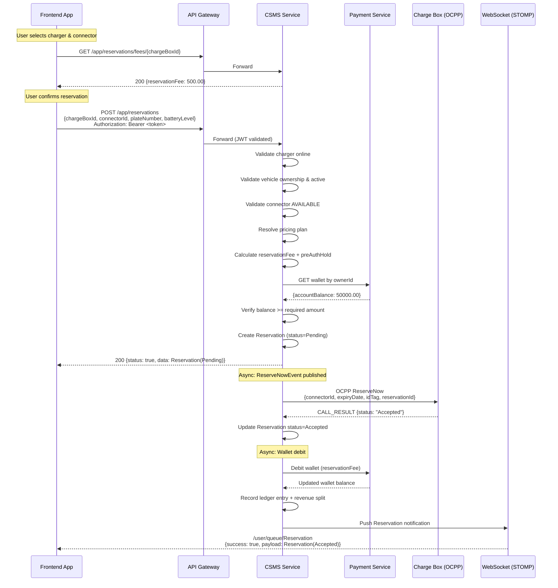
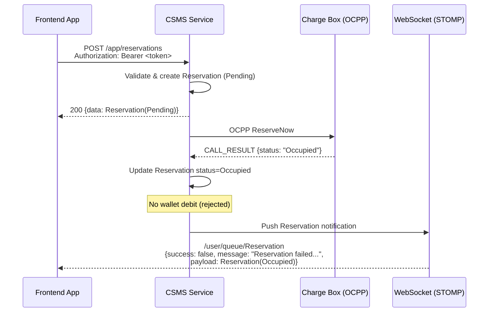
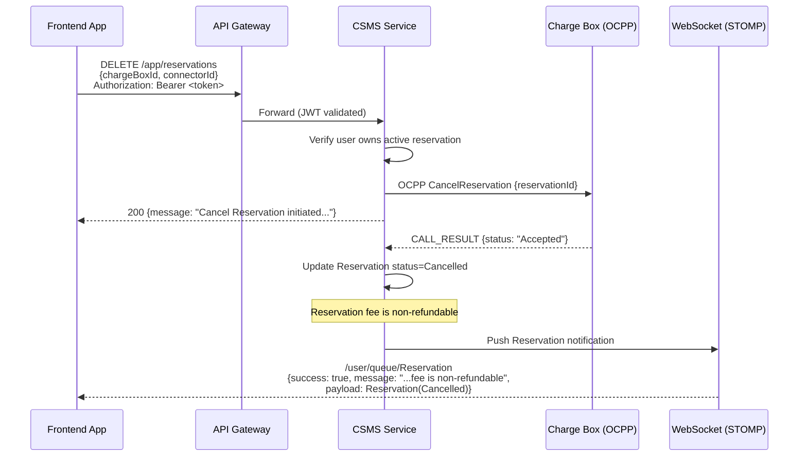
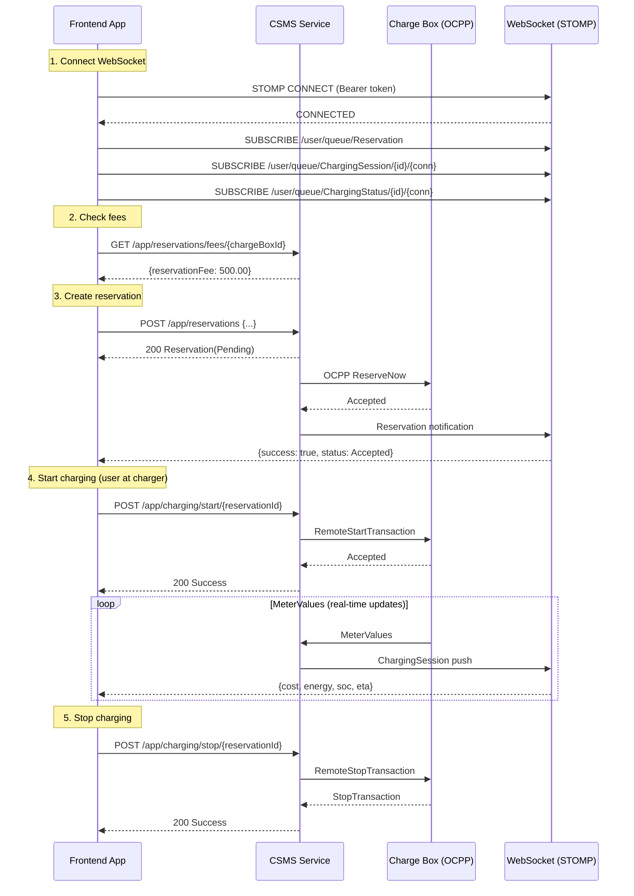
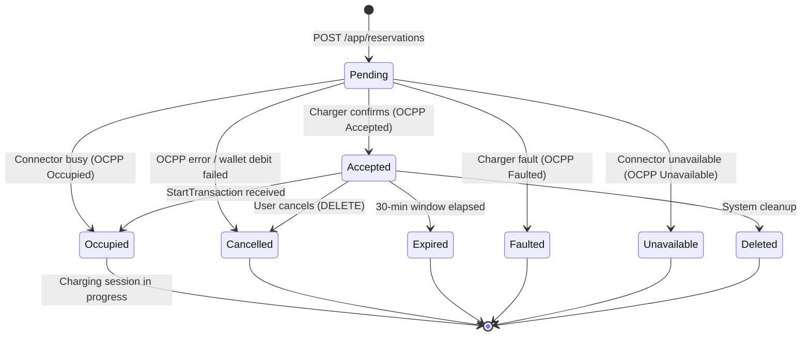

# Reservation Handling — Frontend Integration Guide

> **Audience**: Frontend developers (Vanilla JS, React Native, Flutter)
> **Protocol**: REST (JSON) + STOMP over WebSocket
> **Auth**: Bearer JWT (OAuth2 Resource Server)

---

## Table of Contents

1. [Authentication](#1-authentication)
2. [Get Reservation Fees](#2-get-reservation-fees)
3. [Create Reservation](#3-create-reservation)
4. [Get Active Reservation](#4-get-active-reservation)
5. [List Reservations (Paginated)](#5-list-reservations-paginated)
6. [Cancel Reservation](#6-cancel-reservation)
7. [Real-Time Reservation Notifications (STOMP WebSocket)](#7-real-time-reservation-notifications-stomp-websocket)
8. [Sequence Diagrams](#8-sequence-diagrams)
9. [Payload Reference](#9-payload-reference)
10. [Error Handling](#10-error-handling)

---

## 1. Authentication

All endpoints except [Get Reservation Fees](#2-get-reservation-fees) require a valid **access token**. See [charging-session-handling-docs.md](charging-session-handling-docs.md#1-authentication) for the full two-phase login flow.

**Every authenticated request must include:**

```
Authorization: Bearer <accessToken>
```

**WebSocket STOMP connections** pass the token in the CONNECT frame:

```
CONNECT
accept-version:1.2
Authorization:Bearer <accessToken>
heart-beat:10000,10000

^@
```

---

## 2. Get Reservation Fees

Query the reservation fee before creating a reservation. **No authentication required.**

```
GET /app/reservations/fees/{chargeBoxId}
```

| Parameter     | In   | Type   | Required | Description        |
|---------------|------|--------|----------|--------------------|
| `chargeBoxId` | path | string | yes      | Charger identifier |

**Success Response (200):**

```json
{
  "status": true,
  "code": 200,
  "message": "Reservation fees for charger SC-DC-001",
  "data": {
    "reservationFee": 500.00
  }
}
```

| Field            | Type    | Description                     |
|------------------|---------|---------------------------------|
| `reservationFee` | decimal | Flat reservation fee (in RWF)   |

**Error Responses:**

| Code | Message                           |
|------|-----------------------------------|
| 404  | `Charger {chargeBoxId} not found` |

---

## 3. Create Reservation

```
POST /app/reservations
Authorization: Bearer <accessToken>
Content-Type: application/json
```

**Request Body:**

```json
{
  "chargeBoxId": "SC-DC-001",
  "connectorId": 1,
  "plateNumber": "KDA 123A",
  "currentBatteryLevel": 20
}
```

| Field                 | Type   | Validation           | Description                 |
|-----------------------|--------|----------------------|-----------------------------|
| `chargeBoxId`         | string | required, not empty  | Target charger ID           |
| `connectorId`         | long   | required, not null   | Connector number on charger |
| `plateNumber`         | string | required, not empty  | Vehicle license plate       |
| `currentBatteryLevel` | int    | required, range 0–95 | Current battery percentage  |

**Success Response (200):**

```json
{
  "status": true,
  "code": 200,
  "message": "Reservation initiated for idTag SC-DC-001",
  "data": {
    "id": 99,
    "transactionId": null,
    "idTag": "SC-DC-001",
    "startTime": "2026-05-08 14:30:00",
    "expiryDateTime": "2026-05-08 15:00:00",
    "status": "Pending",
    "chargeBoxId": "SC-DC-001",
    "connectorId": 1,
    "reservationAmount": 500.00,
    "chargingAmount": 2800.00,
    "walletAccount": "WAL-001",
    "walletBalance": 50000.00,
    "batteryLevel": 20,
    "batteryCapacity": 75,
    "connectorType": "DC_TYPE2_CCS2",
    "username": "42"
  }
}
```

> **Important**: The REST response returns the reservation with status `Pending`. The actual OCPP confirmation arrives asynchronously via the [WebSocket notification](#7-real-time-reservation-notifications-stomp-websocket). Listen for the `Reservation` topic to know whether the charger accepted or rejected the reservation.

### Server-Side Validation Order

1. Charger must exist and be online
2. No duplicate active reservation on same connector (returns existing if found)
3. Vehicle must exist, belong to authenticated user, and be active
4. Connector status must be `AVAILABLE`
5. Pricing plan resolved (operator-specific or platform default)
6. Wallet balance must cover `reservationFee + preAuthHold`

**Error Responses:**

| Code | Message                                                                                                                    |
|------|----------------------------------------------------------------------------------------------------------------------------|
| 400  | `chargeBoxId cannot be empty`                                                                                              |
| 400  | `connector number cannot be null`                                                                                          |
| 400  | `Vehicle plate number is required!`                                                                                        |
| 400  | `Battery level must be between 0 and 95%`                                                                                  |
| 404  | `Charger {chargeBoxId} not found`                                                                                          |
| 404  | `Reservation failed - Vehicle {plateNumber} does not belong to you!`                                                       |
| 404  | `Connector {connectorId} not found on ChargeBox {chargeBoxId}!`                                                            |
| 409  | `Reservation failed - Charger {chargeBoxId} is offline! Please try again later`                                            |
| 409  | `Reservation failed - Vehicle {plateNumber} is not active`                                                                 |
| 409  | `Connector {connectorId} cannot be reserved! status={status}`                                                              |
| 409  | `Reservation failed - Unable to retrieve wallet for user {userId}!`                                                        |
| 409  | `Reservation failed - Insufficient funds! Required {total} RWF (reservation {fee} + hold {hold}), available {balance} RWF` |
| 503  | `Reservation failed — charger unreachable: {error}`                                                                        |

---

## 4. Get Active Reservation

```
GET /app/reservations/active?walletAccount={walletAccount}
Authorization: Bearer <accessToken>
```

| Parameter       | In    | Type   | Required | Description               |
|-----------------|-------|--------|----------|---------------------------|
| `walletAccount` | query | string | yes      | Wallet account number     |

The server verifies that the wallet belongs to the authenticated user before returning the reservation.

**Success Response (200):** Full [Reservation](#91-reservation-entity) object.

**Error Responses:**

| Code | Message                                                          |
|------|------------------------------------------------------------------|
| 403  | `Access denied — wallet account does not belong to your account` |
| 404  | `No reservation found for account {walletAccount}`               |
| 500  | `Unable to verify wallet ownership for your account`             |

---

## 5. List Reservations (Paginated)

```
GET /app/reservations
Authorization: Bearer <accessToken>
```

| Parameter | In    | Type   | Default | Description                                    |
|-----------|-------|--------|---------|------------------------------------------------|
| `page`    | query | int    | 0       | Zero-based page index                          |
| `size`    | query | int    | 20      | Records per page                               |
| `sort`    | query | string | —       | Sort field + direction (e.g. `startTime,desc`) |

**Response (200):**

```json
{
  "content": [
    {
      "id": 99,
      "transactionId": null,
      "idTag": "SC-DC-001",
      "startTime": "2026-05-08 14:30:00",
      "expiryDateTime": "2026-05-08 15:00:00",
      "reservationStatus": "Accepted",
      "chargeBoxId": "SC-DC-001",
      "connectorId": 1,
      "locationAddress": "Westlands Hub",
      "connectorStatus": "RESERVED"
    }
  ],
  "pageable": {
    "pageNumber": 0,
    "pageSize": 20
  },
  "totalPages": 3,
  "totalElements": 42,
  "last": false,
  "first": true,
  "empty": false
}
```

**`content[]` fields:**

| Field               | Type   | Description                                                    |
|---------------------|--------|----------------------------------------------------------------|
| `id`                | long   | Reservation ID                                                 |
| `transactionId`     | long?  | OCPP transaction ID (null until charging starts)               |
| `idTag`             | string | Charger identification tag                                     |
| `startTime`         | string | Reservation start (`yyyy-MM-dd HH:mm:ss`, Africa/Kigali TZ)    |
| `expiryDateTime`    | string | Reservation expiry (same format)                               |
| `reservationStatus` | string | See [Reservation Status Values](#93-reservation-status-values) |
| `chargeBoxId`       | string | Charger identifier                                             |
| `connectorId`       | int    | Connector number                                               |
| `locationAddress`   | string | Charger location                                               |
| `connectorStatus`   | string | See [Connector Status Values](#94-connector-status-values)     |

---

## 6. Cancel Reservation

```
DELETE /app/reservations
Authorization: Bearer <accessToken>
Content-Type: application/json
```

**Request Body:**

```json
{
  "chargeBoxId": "SC-DC-001",
  "connectorId": 1
}
```

| Field         | Type   | Description              |
|---------------|--------|--------------------------|
| `chargeBoxId` | string | Charger identifier       |
| `connectorId` | long   | Connector number         |

The server verifies that the authenticated user owns the active reservation on this connector before sending the OCPP cancel command.

**Success Response (200):**

```json
{
  "status": true,
  "code": 200,
  "message": "Cancel Reservation initiated for ChargeBoxId SC-DC-001"
}
```

> **Important**: Like creation, cancellation is asynchronous. The REST response confirms the OCPP cancel command was sent. The actual result arrives via the [WebSocket notification](#7-real-time-reservation-notifications-stomp-websocket).

> **Note**: The reservation fee is **non-refundable**.

**Error Responses:**

| Code | Message                                                                                               |
|------|-------------------------------------------------------------------------------------------------------|
| 403  | `Cancel failed — no active reservation found for your account on this connector`                      |
| 404  | `Cancel reservation failed — no active reservation for charger {chargeBoxId} connector {connectorId}` |
| 500  | `cancelReservation failed - {error}`                                                                  |

---

## 7. Real-Time Reservation Notifications (STOMP WebSocket)

### 7.1 Connection

See [charging-session-handling-docs.md, Section 5.1](charging-session-handling-docs.md#51-connection) for full WebSocket connection setup.

**Endpoint:** `ws://<host>/ws/push` (or `wss://` for TLS)

### 7.2 Subscription Topic

```
/user/queue/Reservation
```

> **Why `/user/queue/...` without a userId?** Spring's user-destination mechanism maps the subscription to the authenticated principal from the STOMP CONNECT handshake. The server calls `convertAndSendToUser(userId, "/queue/Reservation", payload)` internally — Spring resolves which session belongs to that userId. See [charging-session-handling-docs.md, Section 5.2](charging-session-handling-docs.md#52-subscription-topics) for detailed explanation.

### 7.3 Notification Payloads

All notifications follow this envelope:

```json
{
  "to": "{userId}",
  "success": true|false,
  "message": "Human-readable description",
  "payload": { /* Reservation entity */ }
}
```

#### Reservation Accepted (charger confirmed)

```json
{
  "to": "42",
  "success": true,
  "message": "Reservation successful for IdTag SC-DC-001",
  "payload": {
    "id": 99,
    "status": "Accepted",
    "chargeBoxId": "SC-DC-001",
    "connectorId": 1,
    "startTime": "2026-05-08 14:30:00",
    "expiryDateTime": "2026-05-08 15:00:00",
    "reservationAmount": 500.00,
    "chargingAmount": 2800.00,
    "walletAccount": "WAL-001",
    "walletBalance": 49500.00,
    "batteryLevel": 20,
    "batteryCapacity": 75,
    "connectorType": "DC_TYPE2_CCS2"
  }
}
```

#### Reservation Rejected (charger refused)

```json
{
  "to": "42",
  "success": false,
  "message": "Reservation failed for IdTag SC-DC-001",
  "payload": {
    "id": 99,
    "status": "Faulted",
    "chargeBoxId": "SC-DC-001",
    "connectorId": 1
  }
}
```

Possible rejection statuses: `Faulted`, `Occupied`, `Unavailable`.

#### Reservation OCPP Error (charger communication error)

```json
{
  "to": "42",
  "success": false,
  "message": "Reservation failed for idTag SC-DC-001 — charger error: InternalError",
  "payload": {
    "id": 99,
    "status": "Cancelled",
    "chargeBoxId": "SC-DC-001",
    "connectorId": 1
  }
}
```

#### Reservation Cancelled (user-initiated)

```json
{
  "to": "42",
  "success": true,
  "message": "Reservation cancelled for IdTag SC-DC-001 — reservation fee is non-refundable",
  "payload": {
    "id": 99,
    "status": "Cancelled",
    "chargeBoxId": "SC-DC-001",
    "connectorId": 1
  }
}
```

#### Cancellation Failed (charger rejected)

```json
{
  "to": "42",
  "success": false,
  "message": "Cancellation failed for idTag SC-DC-001 — charger rejected the request. Please contact support.",
  "payload": {
    "id": 99,
    "status": "Expired",
    "chargeBoxId": "SC-DC-001",
    "connectorId": 1
  }
}
```

#### Wallet Debit Failed (reservation cancelled automatically)

```json
{
  "to": "42",
  "success": false,
  "message": "Reservation failed for IdTag SC-DC-001",
  "payload": {
    "id": 99,
    "status": "Cancelled",
    "chargeBoxId": "SC-DC-001",
    "connectorId": 1
  }
}
```

### 7.4 Subscription Examples

#### Vanilla JS

```javascript
import { Client } from '@stomp/stompjs';
import SockJS from 'sockjs-client';

const client = new Client({
  webSocketFactory: () => new SockJS('https://api.example.com/ws/push'),
  connectHeaders: { Authorization: `Bearer ${accessToken}` },
  heartbeatIncoming: 10000,
  heartbeatOutgoing: 10000,
  reconnectDelay: 5000,

  onConnect: () => {
    client.subscribe('/user/queue/Reservation', (message) => {
      const notification = JSON.parse(message.body);

      if (notification.success) {
        console.log('Reservation confirmed:', notification.payload.status);
        // Update UI — show reservation details, start countdown timer
      } else {
        console.error('Reservation failed:', notification.message);
        // Show error to user
      }
    });
  }
});

client.activate();
```

#### React Native

```javascript
import { Client } from '@stomp/stompjs';

const client = new Client({
  brokerURL: 'wss://api.example.com/ws/push',
  connectHeaders: { Authorization: `Bearer ${accessToken}` },
  heartbeatIncoming: 10000,
  heartbeatOutgoing: 10000,
  reconnectDelay: 5000,

  onConnect: () => {
    client.subscribe('/user/queue/Reservation', (message) => {
      const notification = JSON.parse(message.body);
      // Update React state
    });
  }
});

client.activate();
```

#### Flutter

```dart
import 'package:stomp_dart_client/stomp_dart_client.dart';
import 'dart:convert';

final client = StompClient(
  config: StompConfig(
    url: 'wss://api.example.com/ws/push',
    stompConnectHeaders: {
      'Authorization': 'Bearer $accessToken',
    },
    heartbeatIncoming: const Duration(seconds: 10),
    heartbeatOutgoing: const Duration(seconds: 10),
    reconnectDelay: const Duration(seconds: 5),
    onConnect: (StompFrame frame) {
      client.subscribe(
        destination: '/user/queue/Reservation',
        callback: (StompFrame frame) {
          final notification = jsonDecode(frame.body!);
          if (notification['success'] == true) {
            // Reservation confirmed — update state
          } else {
            // Reservation failed — show error
          }
        },
      );
    },
  ),
);

client.activate();
```

---

## 8. Sequence Diagrams

### 8.1 Create Reservation Flow



### 8.2 Create Reservation — Charger Rejects



### 8.3 Cancel Reservation Flow



### 8.4 Full End-to-End Flow (Fees → Reserve → Charge → Stop)



### 8.5 Reservation State Machine



---

## 9. Payload Reference

### 9.1 Reservation Entity

Full reservation object returned by create, get-active, and WebSocket notifications:

```json
{
  "id": 99,
  "transactionId": null,
  "idTag": "SC-DC-001",
  "startTime": "2026-05-08 14:30:00",
  "expiryDateTime": "2026-05-08 15:00:00",
  "status": "Accepted",
  "chargeBoxId": "SC-DC-001",
  "connectorId": 1,
  "reservationAmount": 500.00,
  "chargingAmount": 2800.00,
  "walletAccount": "WAL-001",
  "walletBalance": 49500.00,
  "batteryLevel": 20,
  "batteryCapacity": 75,
  "connectorType": "DC_TYPE2_CCS2",
  "username": "42"
}
```

| Field               | Type    | Description                                                 |
|---------------------|---------|-------------------------------------------------------------|
| `id`                | long    | Unique reservation ID                                       |
| `transactionId`     | long?   | OCPP transaction ID (null until charging starts)            |
| `idTag`             | string  | Charger identification tag                                  |
| `startTime`         | string  | Reservation start (`yyyy-MM-dd HH:mm:ss`, Africa/Kigali TZ) |
| `expiryDateTime`    | string  | Reservation expiry (30 min from start, same format)         |
| `status`            | string  | Current status (see [9.3](#93-reservation-status-values))   |
| `chargeBoxId`       | string  | Charger identifier                                          |
| `connectorId`       | long    | Connector number on charger                                 |
| `reservationAmount` | decimal | Reservation fee charged (RWF)                               |
| `chargingAmount`    | decimal | Pre-authorization hold amount (RWF)                         |
| `walletAccount`     | string  | Wallet account number used                                  |
| `walletBalance`     | decimal | Wallet balance snapshot at reservation time (RWF)           |
| `batteryLevel`      | int     | Vehicle battery level at reservation (0–95%)                |
| `batteryCapacity`   | int     | Vehicle battery capacity (kWh)                              |
| `connectorType`     | string  | Connector type (see [9.5](#95-connector-type-values))       |
| `username`          | string  | User account ID (from JWT)                                  |

### 9.2 Generic Response Envelope

All REST responses are wrapped in:

```json
{
  "status": true,
  "code": 200,
  "message": "Human-readable message",
  "data": null
}
```

| Field     | Type    | Description                       |
|-----------|---------|-----------------------------------|
| `status`  | boolean | `true` = success, `false` = error |
| `code`    | int     | HTTP status code                  |
| `message` | string  | Description of result             |
| `data`    | T/null  | Response payload (nullable)       |

### 9.3 Reservation Status Values

| Status        | Description                                      | Terminal? |
|---------------|--------------------------------------------------|-----------|
| `Pending`     | Awaiting charger OCPP response                   | No        |
| `Accepted`    | Charger confirmed, connector reserved            | No        |
| `Occupied`    | Charging session started on this reservation     | Yes       |
| `Cancelled`   | Cancelled by user, OCPP error, or wallet failure | Yes       |
| `Expired`     | 30-minute reservation window elapsed             | Yes       |
| `Faulted`     | Charger reported a fault                         | Yes       |
| `Unavailable` | Connector became unavailable                     | Yes       |
| `Deleted`     | Removed by system                                | Yes       |

### 9.4 Connector Status Values

| Status          | Description                               |
|-----------------|-------------------------------------------|
| `AVAILABLE`     | Ready for reservation/use                 |
| `PREPARING`     | Vehicle connected, preparing to charge    |
| `CHARGING`      | Actively charging                         |
| `SUSPENDEDEVSE` | Suspended by charger                      |
| `SUSPENDEDEV`   | Suspended by vehicle                      |
| `FINISHING`     | Finishing charge session                  |
| `RESERVED`      | Reserved for a user                       |
| `UNAVAILABLE`   | Out of service                            |
| `FAULTED`       | Hardware fault                            |
| `OCCUPIED`      | Connector occupied                        |

### 9.5 Connector Type Values

| Value                  | Description            |
|------------------------|------------------------|
| `AC_TYPE1_SEA_J1772`   | AC Type 1 (SAE J1772)  |
| `AC_TYPE2_MENNEKES`    | AC Type 2 (Mennekes)   |
| `AC_GBT`               | AC GB/T (China)        |
| `DC_GBT`               | DC GB/T (China)        |
| `DC_CHAdeMO`           | DC CHAdeMO             |
| `DC_CHAOJI_CHAdeMO3`   | DC ChaoJi (CHAdeMO 3)  |
| `DC_TYPE1_CCS1`        | DC CCS Combo 1         |
| `DC_TYPE2_CCS2`        | DC CCS Combo 2         |
| `TESLA`                | Tesla connector        |

### 9.6 WebSocket Notification Envelope

```json
{
  "to": "{userId}",
  "success": true,
  "message": "Human-readable description",
  "payload": { /* Reservation entity */ }
}
```

| Field     | Type    | Description                                      |
|-----------|---------|--------------------------------------------------|
| `to`      | string  | Target user ID                                   |
| `success` | boolean | `true` = operation succeeded, `false` = failed   |
| `message` | string  | Description (show to user on failure)            |
| `payload` | object  | Full Reservation entity                          |

### 9.7 ReservationFees

```json
{
  "reservationFee": 500.00
}
```

---

## 10. Error Handling

### 10.1 HTTP Status Codes

| Code | Meaning              | Action                                    |
|------|----------------------|-------------------------------------------|
| 200  | Success              | Process response                          |
| 400  | Validation error     | Show field-level errors to user           |
| 401  | Unauthorized         | Refresh token or redirect to login        |
| 403  | Forbidden            | User lacks permission or ownership        |
| 404  | Not found            | Resource does not exist                   |
| 409  | Conflict             | State conflict (offline, occupied, etc.)  |
| 500  | Server error         | Retry or show generic error               |
| 503  | Service unavailable  | Payment service down, retry later         |

### 10.2 Validation Error Format

When request body validation fails (HTTP 400):

```json
{
  "status": false,
  "code": 400,
  "message": "Validation failed",
  "errors": [
    {
      "field": "chargeBoxId",
      "message": "chargeBoxId cannot be empty"
    },
    {
      "field": "currentBatteryLevel",
      "message": "Battery level must be between 0 and 95%"
    }
  ]
}
```

### 10.3 Handling Asynchronous Failures

Both create and cancel are **async operations**. The REST response only confirms the request was accepted. The actual outcome arrives via WebSocket.

**Recommended frontend pattern:**

1. Call REST endpoint → show "pending" state in UI
2. Listen on `/user/queue/Reservation` for the result
3. On `success: true` → update UI to confirmed state
4. On `success: false` → show error from `message` field, revert UI

**If WebSocket disconnects** before receiving the result:
- Reconnect and re-subscribe
- Call `GET /app/reservations/active?walletAccount={account}` to fetch current state
- Messages sent during disconnection are **not queued**

### 10.4 Token Expiry

- **Access token**: 1 hour TTL. On 401, call `POST /refresh`, retry request.
- **Refresh token**: 7 days TTL. On refresh failure, redirect to login.
- **WebSocket**: Reconnect with fresh token if connection drops.

---

## Appendix: Quick Reference

### Endpoints Summary

| Method | Path                                   | Auth     | Description              |
|--------|----------------------------------------|----------|--------------------------|
| GET    | `/app/reservations/fees/{chargeBoxId}` | No       | Get reservation fees     |
| POST   | `/app/reservations`                    | Required | Create reservation       |
| GET    | `/app/reservations`                    | Required | List reservations (page) |
| GET    | `/app/reservations/active`             | Required | Get active reservation   |
| DELETE | `/app/reservations`                    | Required | Cancel reservation       |

### WebSocket Topic

| Topic                     | Payload            | When                         |
|---------------------------|--------------------|------------------------------|
| `/user/queue/Reservation` | Reservation entity | Any reservation state change |

### Key Business Rules

- Reservation window: **30 minutes** from creation
- Reservation fee: **non-refundable** on cancellation
- Battery level: must be **0–95%** (95% cap prevents unnecessary charging)
- Connector must be **AVAILABLE** to reserve
- Charger must be **online** to reserve
- One active reservation per connector per user
- Wallet must cover **reservationFee + preAuthHold**
