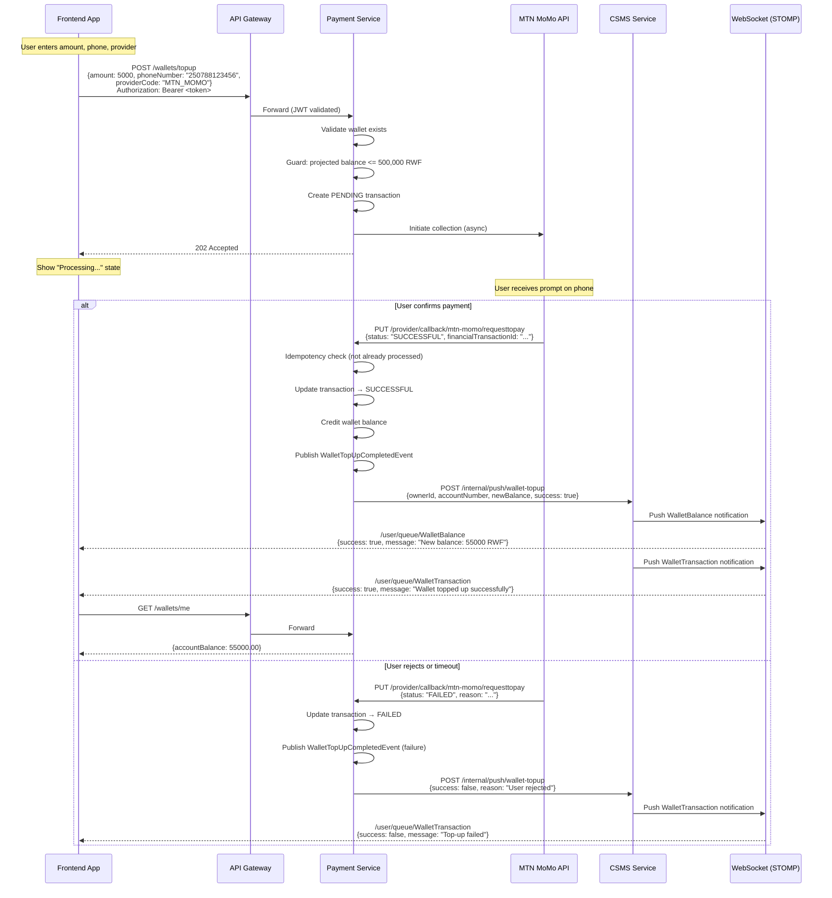
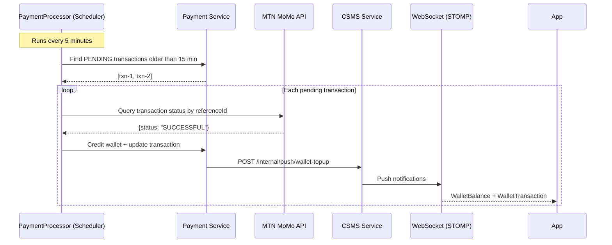
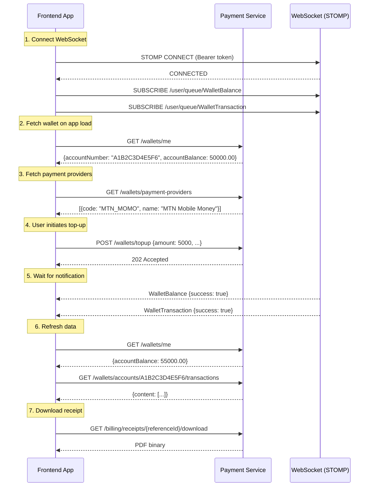
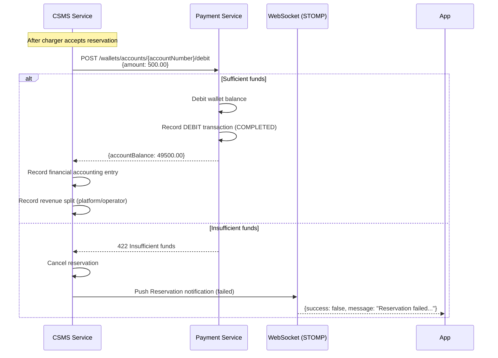

# Wallet Management — Frontend Integration Guide

> **Audience**: Frontend developers (Vanilla JS, React Native, Flutter)
> **Protocol**: REST (JSON) + STOMP over WebSocket
> **Auth**: Bearer JWT (OAuth2 Resource Server)
> **Currency**: RWF (Rwandan Franc)

---

## Table of Contents

1. [Authentication](#1-authentication)
2. [Get Wallet Balance](#2-get-wallet-balance)
3. [Get Wallet by Account Number](#3-get-wallet-by-account-number)
4. [Validate Account Number](#4-validate-account-number)
5. [Top Up Wallet](#5-top-up-wallet)
6. [List Payment Providers](#6-list-payment-providers)
7. [Transaction History](#7-transaction-history)
8. [Billing History](#8-billing-history)
9. [Download Receipts & Invoices](#9-download-receipts--invoices)
10. [Real-Time Wallet Notifications (STOMP WebSocket)](#10-real-time-wallet-notifications-stomp-websocket)
11. [Sequence Diagrams](#11-sequence-diagrams)
12. [Payload Reference](#12-payload-reference)
13. [Error Handling](#13-error-handling)

---

## 1. Authentication

All wallet endpoints require a valid **access token** with `IDENTITY_CUSTOMER` authority. See [charging-session-handling-docs.md](charging-session-handling-docs.md#1-authentication) for the full two-phase login flow.

**Every request must include:**

```
Authorization: Bearer <accessToken>
```

---

## 2. Get Wallet Balance

Fetch the authenticated user's wallet.

```
GET /wallets/me
Authorization: Bearer <accessToken>
```

No parameters — the wallet is resolved from the JWT `sub` claim (ownerId).

**Success Response (200):**

```json
{
  "id": 1,
  "accountNumber": "A1B2C3D4E5F6",
  "ownerId": 42,
  "ownerEmail": "user@example.com",
  "accountBalance": 50000.00,
  "active": true,
  "createdAt": "2026-01-15T10:30:00"
}
```

See [WalletResponse](#121-walletresponse) for field descriptions.

**Error Responses:**

| Code | Message                                  |
|------|------------------------------------------|
| 404  | `Wallet account not found: {ownerId}`    |

---

## 3. Get Wallet by Account Number

```
GET /wallets/accounts/{accountNumber}
Authorization: Bearer <accessToken>
```

| Parameter       | In   | Type   | Required | Description                 |
|-----------------|------|--------|----------|-----------------------------|
| `accountNumber` | path | string | yes      | 12-character account number |

**Response:** Same [WalletResponse](#121-walletresponse) shape as above.

**Error Responses:**

| Code | Message                                          |
|------|--------------------------------------------------|
| 404  | `Wallet account not found: {accountNumber}`      |

---

## 4. Validate Account Number

Check if a wallet account number exists (e.g. for peer transfers).

```
GET /wallets/accounts/{accountNumber}/validate
Authorization: Bearer <accessToken>
```

| Parameter       | In   | Type   | Required | Description                 |
|-----------------|------|--------|----------|-----------------------------|
| `accountNumber` | path | string | yes      | 12-character account number |

**Response (200):**

```json
true
```

Returns `true` if wallet exists, `false` otherwise.

---

## 5. Top Up Wallet

Initiate a mobile money collection to top up the wallet. This is an **asynchronous** operation — the REST response only confirms the request was accepted. The actual result arrives via [WebSocket notification](#10-real-time-wallet-notifications-stomp-websocket) after the mobile money provider processes the payment.

```
POST /wallets/topup
Authorization: Bearer <accessToken>
Content-Type: application/json
```

**Request Body:**

```json
{
  "amount": 5000,
  "phoneNumber": "250788123456",
  "providerCode": "MTN_MOMO"
}
```

| Field          | Type   | Validation                      | Description                        |
|----------------|--------|---------------------------------|------------------------------------|
| `amount`       | int    | required, min 1000              | Top-up amount in RWF               |
| `phoneNumber`  | string | required, format `2507XXXXXXXX` | Mobile money phone number (Rwanda) |
| `providerCode` | string | required, not blank             | Payment provider code              |

**Success Response (202 Accepted):** Empty body.

The user will receive a mobile money prompt on their phone. After they confirm (or the request times out/fails), a push notification arrives on the WebSocket.

**Error Responses:**

| Code | Message                                                                                 |
|------|-----------------------------------------------------------------------------------------|
| 400  | `Minimum top-up amount is 1,000 RWF`                                                    |
| 400  | `Phone number is required`                                                              |
| 400  | `Provider code is required`                                                             |
| 404  | `Payment provider not available: {providerCode}`                                        |
| 422  | `Top-up rejected — resulting balance {balance} RWF would exceed maximum of 500,000 RWF` |

### Business Rules

- **Minimum top-up**: 1,000 RWF
- **Maximum wallet balance**: 500,000 RWF (top-up rejected if projected balance exceeds this)
- **Phone number format**: Must match `2507XXXXXXXX` (12 digits, Rwanda mobile)
- **Pending reconciliation**: If the mobile money callback never arrives, a background scheduler reconciles pending transactions after ~15 minutes

---

## 6. List Payment Providers

Fetch available payment providers for the top-up form.

```
GET /wallets/payment-providers
Authorization: Bearer <accessToken>
```

**Response (200):**

```json
[
  {
    "code": "MTN_MOMO",
    "name": "MTN Mobile Money",
    "iconKey": "mtn_momo"
  }
]
```

| Field     | Type   | Description                            |
|-----------|--------|----------------------------------------|
| `code`    | string | Provider code (use in top-up request)  |
| `name`    | string | Display name                           |
| `iconKey` | string | Icon identifier for UI                 |

---

## 7. Transaction History

### 7.1 Paginated Transaction History

```
GET /wallets/accounts/{accountNumber}/transactions
Authorization: Bearer <accessToken>
```

| Parameter       | In    | Type   | Default          | Description                 |
|-----------------|-------|--------|------------------|-----------------------------|
| `accountNumber` | path  | string | —                | 12-character account number |
| `page`          | query | int    | 0                | Zero-based page index       |
| `size`          | query | int    | 20               | Records per page            |
| `sort`          | query | string | `createdAt,desc` | Sort field + direction      |

**Response (200):**

```json
{
  "content": [
    {
      "id": 101,
      "accountNumber": "A1B2C3D4E5F6",
      "transactedAmount": 5000,
      "referenceId": "a1b2c3d4-e5f6-7890-abcd-ef1234567890",
      "transactionId": "MOMO-FIN-TXN-001",
      "status": "SUCCESSFUL",
      "type": "CREDIT",
      "createdAt": "2026-05-08T14:30:00"
    },
    {
      "id": 100,
      "accountNumber": "A1B2C3D4E5F6",
      "transactedAmount": 500,
      "referenceId": "b2c3d4e5-f6a7-8901-bcde-f12345678901",
      "transactionId": "b2c3d4e5-f6a7-8901-bcde-f12345678901",
      "status": "COMPLETED",
      "type": "DEBIT",
      "createdAt": "2026-05-08T15:00:00"
    }
  ],
  "pageable": { "pageNumber": 0, "pageSize": 20 },
  "totalPages": 3,
  "totalElements": 42,
  "last": false,
  "first": true,
  "empty": false
}
```

See [WalletTransactionResponse](#122-wallettransactionresponse) for field descriptions.

### 7.2 Recent Transactions

Returns the 5 most recent transactions (useful for dashboard widgets).

```
GET /wallets/accounts/{accountNumber}/transactions/recents
Authorization: Bearer <accessToken>
```

| Parameter       | In   | Type   | Required | Description                 |
|-----------------|------|--------|----------|-----------------------------|
| `accountNumber` | path | string | yes      | 12-character account number |

**Response:** Same paginated shape, fixed to 5 items sorted by `createdAt` descending.

---

## 8. Billing History

Detailed financial accounting records (reservation fees, charging fees, refunds).

```
GET /billing/history
Authorization: Bearer <accessToken>
```

| Parameter | In    | Type   | Default | Description              |
|-----------|-------|--------|---------|--------------------------|
| `page`    | query | int    | 0       | Zero-based page index    |
| `size`    | query | int    | 20      | Records per page         |
| `sort`    | query | string | —       | Sort field + direction   |

**Response (200):**

```json
{
  "content": [
    {
      "id": 50,
      "reservationId": 99,
      "accountNumber": "A1B2C3D4E5F6",
      "ownerId": 42,
      "username": "42",
      "transactionType": "PAY_RESERVATION_FEE",
      "amountFee": 500.00,
      "oldBalance": 50000.00,
      "newBalance": 49500.00,
      "chargerId": "SC-DC-001",
      "connectorId": 1,
      "paymentSource": "WALLET",
      "financialTransactionType": "DEBIT",
      "createdAt": "2026-05-08T14:35:00"
    }
  ],
  "pageable": { "pageNumber": 0, "pageSize": 20 },
  "totalPages": 2,
  "totalElements": 25
}
```

See [FinancialAccounting](#123-financialaccounting) for field descriptions.

---

## 9. Download Receipts & Invoices

All download endpoints return a PDF binary. Set the response as a file download.

### 9.1 Top-Up Receipt

```
GET /billing/receipts/{referenceId}/download
Authorization: Bearer <accessToken>
```

| Parameter     | In   | Type   | Required | Description                     |
|---------------|------|--------|----------|---------------------------------|
| `referenceId` | path | string | yes      | Transaction reference ID (UUID) |

**Response:** `application/pdf` binary with header `Content-Disposition: attachment; filename="receipt-{referenceId}.pdf"`

### 9.2 Reservation Invoice

```
GET /billing/invoices/reservation/{reservationId}/download
Authorization: Bearer <accessToken>
```

| Parameter       | In   | Type | Required | Description    |
|-----------------|------|------|----------|----------------|
| `reservationId` | path | long | yes      | Reservation ID |

**Response:** `application/pdf` binary with header `Content-Disposition: attachment; filename="reservation-invoice-{reservationId}.pdf"`

### 9.3 Charging Session Invoice

```
GET /billing/invoices/charging/{sessionId}/download
Authorization: Bearer <accessToken>
```

| Parameter   | In   | Type   | Required | Description         |
|-------------|------|--------|----------|---------------------|
| `sessionId` | path | string | yes      | Charging session ID |

**Response:** `application/pdf` binary with header `Content-Disposition: attachment; filename="charging-invoice-{sessionId}.pdf"`

### Download Example (Vanilla JS)

```javascript
async function downloadPdf(url, filename) {
  const response = await fetch(url, {
    headers: { Authorization: `Bearer ${accessToken}` }
  });
  const blob = await response.blob();
  const link = document.createElement('a');
  link.href = URL.createObjectURL(blob);
  link.download = filename;
  link.click();
  URL.revokeObjectURL(link.href);
}

// Download a top-up receipt
downloadPdf(
  `/billing/receipts/${referenceId}/download`,
  `receipt-${referenceId}.pdf`
);
```

### Download Example (Flutter)

```dart
import 'package:dio/dio.dart';
import 'package:path_provider/path_provider.dart';

Future<String> downloadReceipt(String referenceId) async {
  final dir = await getApplicationDocumentsDirectory();
  final path = '${dir.path}/receipt-$referenceId.pdf';

  await dio.download(
    '/billing/receipts/$referenceId/download',
    path,
    options: Options(
      headers: {'Authorization': 'Bearer $accessToken'},
    ),
  );
  return path;
}
```

---

## 10. Real-Time Wallet Notifications (STOMP WebSocket)

### 10.1 Connection

See [charging-session-handling-docs.md, Section 5.1](charging-session-handling-docs.md#51-connection) for full WebSocket connection setup.

### 10.2 Subscription Topics

#### Wallet Balance Updates

```
/user/queue/WalletBalance
```

Fires when wallet balance changes (top-up success/failure, refund).

**Payload:**

```json
{
  "to": "42",
  "success": true,
  "message": "New balance: 55000 RWF",
  "payload": null
}
```

> **Note**: `payload` is `null`. Fetch updated balance from `GET /wallets/me` after receiving this notification.

#### Wallet Transaction Updates

```
/user/queue/WalletTransaction
```

Fires after a wallet transaction completes (top-up, refund).

**Payload:**

```json
{
  "to": "42",
  "success": true,
  "message": "Wallet topped up successfully",
  "payload": null
}
```

> **Note**: `payload` is `null`. Fetch updated transactions from `GET /wallets/accounts/{accountNumber}/transactions` after receiving this notification.

### 10.3 Why Payload is Null

Both wallet notification topics send `payload: null`. This is intentional — the notification acts as a **signal** to refresh data from the REST API. This avoids stale data issues and ensures the frontend always displays the authoritative balance from the server.

**Recommended pattern:**

1. Subscribe to both `/user/queue/WalletBalance` and `/user/queue/WalletTransaction`
2. On notification received → call `GET /wallets/me` to refresh balance
3. On transaction notification → optionally refresh transaction list
4. Use `success` field to show success/error toast
5. Use `message` field as toast text

### 10.4 Subscription Examples

#### Vanilla JS

```javascript
import { Client } from '@stomp/stompjs';
import SockJS from 'sockjs-client';

const client = new Client({
  webSocketFactory: () => new SockJS('https://api.example.com/ws/push'),
  connectHeaders: { Authorization: `Bearer ${accessToken}` },
  heartbeatIncoming: 10000,
  heartbeatOutgoing: 10000,
  reconnectDelay: 5000,

  onConnect: () => {
    // Balance updates
    client.subscribe('/user/queue/WalletBalance', (message) => {
      const notification = JSON.parse(message.body);
      if (notification.success) {
        fetchWalletBalance(); // Refresh from API
        showToast('success', notification.message);
      } else {
        showToast('error', notification.message);
      }
    });

    // Transaction updates
    client.subscribe('/user/queue/WalletTransaction', (message) => {
      const notification = JSON.parse(message.body);
      if (notification.success) {
        fetchTransactionHistory(); // Refresh from API
      }
    });
  }
});

client.activate();
```

#### React Native

```javascript
import { Client } from '@stomp/stompjs';

const client = new Client({
  brokerURL: 'wss://api.example.com/ws/push',
  connectHeaders: { Authorization: `Bearer ${accessToken}` },
  heartbeatIncoming: 10000,
  heartbeatOutgoing: 10000,
  reconnectDelay: 5000,

  onConnect: () => {
    client.subscribe('/user/queue/WalletBalance', (message) => {
      const notification = JSON.parse(message.body);
      // Update React state → trigger balance refresh
    });

    client.subscribe('/user/queue/WalletTransaction', (message) => {
      const notification = JSON.parse(message.body);
      // Update React state → trigger transaction list refresh
    });
  }
});

client.activate();
// Cleanup on unmount: client.deactivate();
```

#### Flutter

```dart
import 'package:stomp_dart_client/stomp_dart_client.dart';
import 'dart:convert';

final client = StompClient(
  config: StompConfig(
    url: 'wss://api.example.com/ws/push',
    stompConnectHeaders: {
      'Authorization': 'Bearer $accessToken',
    },
    heartbeatIncoming: const Duration(seconds: 10),
    heartbeatOutgoing: const Duration(seconds: 10),
    reconnectDelay: const Duration(seconds: 5),
    onConnect: (StompFrame frame) {
      // Balance updates
      client.subscribe(
        destination: '/user/queue/WalletBalance',
        callback: (StompFrame frame) {
          final notification = jsonDecode(frame.body!);
          // Refresh wallet balance from API
        },
      );

      // Transaction updates
      client.subscribe(
        destination: '/user/queue/WalletTransaction',
        callback: (StompFrame frame) {
          final notification = jsonDecode(frame.body!);
          // Refresh transaction list from API
        },
      );
    },
  ),
);

client.activate();
```

---

## 11. Sequence Diagrams

### 11.1 Wallet Top-Up Flow (Mobile Money)



### 11.2 Top-Up Reconciliation (Missed Callback)



### 11.3 Wallet Balance Check + Top-Up + View History



### 11.4 Reservation Fee Debit (Internal — For Context)



---

## 12. Payload Reference

### 12.1 WalletResponse

Returned by `GET /wallets/me`, `GET /wallets/accounts/{accountNumber}`.

```json
{
  "id": 1,
  "accountNumber": "A1B2C3D4E5F6",
  "ownerId": 42,
  "ownerEmail": "user@example.com",
  "accountBalance": 50000.00,
  "active": true,
  "createdAt": "2026-01-15T10:30:00"
}
```

| Field            | Type     | Description                              |
|------------------|----------|------------------------------------------|
| `id`             | long     | Wallet ID                                |
| `accountNumber`  | string   | Unique 12-character account number       |
| `ownerId`        | long     | User account ID (from JWT `sub`)         |
| `ownerEmail`     | string   | Account owner email                      |
| `accountBalance` | decimal  | Current balance in RWF                   |
| `active`         | boolean  | Whether wallet is active                 |
| `createdAt`      | datetime | Wallet creation timestamp (ISO-8601)     |

### 12.2 WalletTransactionResponse

Returned in paginated `content[]` from transaction history endpoints.

```json
{
  "id": 101,
  "accountNumber": "A1B2C3D4E5F6",
  "transactedAmount": 5000,
  "referenceId": "a1b2c3d4-e5f6-7890-abcd-ef1234567890",
  "transactionId": "MOMO-FIN-TXN-001",
  "status": "SUCCESSFUL",
  "type": "CREDIT",
  "createdAt": "2026-05-08T14:30:00"
}
```

| Field              | Type     | Description                                               |
|--------------------|----------|-----------------------------------------------------------|
| `id`               | long     | Transaction record ID                                     |
| `accountNumber`    | string   | Wallet account number                                     |
| `transactedAmount` | long     | Amount in RWF (integer)                                   |
| `referenceId`      | string   | UUID reference (use for receipt download)                 |
| `transactionId`    | string   | MoMo financial transaction ID (or UUID for internal txns) |
| `status`           | string   | See [Payment Status](#124-payment-status-values)          |
| `type`             | string   | See [Transaction Type](#125-transaction-type-values)      |
| `createdAt`        | datetime | Transaction timestamp (ISO-8601)                          |

### 12.3 FinancialAccounting

Returned in paginated `content[]` from billing history.

```json
{
  "id": 50,
  "reservationId": 99,
  "accountNumber": "A1B2C3D4E5F6",
  "ownerId": 42,
  "username": "42",
  "transactionType": "PAY_RESERVATION_FEE",
  "amountFee": 500.00,
  "oldBalance": 50000.00,
  "newBalance": 49500.00,
  "chargerId": "SC-DC-001",
  "connectorId": 1,
  "paymentSource": "WALLET",
  "financialTransactionType": "DEBIT",
  "createdAt": "2026-05-08T14:35:00"
}
```

| Field                      | Type     | Description                                                         |
|----------------------------|----------|---------------------------------------------------------------------|
| `id`                       | long     | Record ID                                                           |
| `reservationId`            | long?    | Linked reservation ID (null for top-ups)                            |
| `accountNumber`            | string   | Wallet account number                                               |
| `ownerId`                  | long     | User account ID                                                     |
| `username`                 | string   | Username                                                            |
| `transactionType`          | string   | See [Accounting Transaction Type](#126-accounting-transaction-type) |
| `amountFee`                | decimal  | Transaction amount (RWF)                                            |
| `oldBalance`               | decimal  | Balance before transaction (RWF)                                    |
| `newBalance`               | decimal  | Balance after transaction (RWF)                                     |
| `chargerId`                | string?  | Charger identifier (null for top-ups)                               |
| `connectorId`              | long?    | Connector number (null for top-ups)                                 |
| `paymentSource`            | string   | See [Payment Source](#127-payment-source-values)                    |
| `financialTransactionType` | string   | `DEBIT` or `CREDIT`                                                 |
| `createdAt`                | datetime | Timestamp (ISO-8601)                                                |

### 12.4 Payment Status Values

| Status       | Description                                            |
|--------------|--------------------------------------------------------|
| `PENDING`    | Transaction initiated, awaiting provider response      |
| `SUCCESSFUL` | Payment collected successfully                         |
| `COMPLETED`  | Internal completion (equivalent to SUCCESSFUL)         |
| `FAILED`     | Payment failed (insufficient funds, rejected, timeout) |

### 12.5 Transaction Type Values

| Type     | Description                                            |
|----------|--------------------------------------------------------|
| `CREDIT` | Amount added to wallet (top-up)                        |
| `DEBIT`  | Amount deducted from wallet (reservation/charging fee) |
| `REFUND` | Reversal of prior debit                                |

### 12.6 Accounting Transaction Type

| Type                     | Description              |
|--------------------------|--------------------------|
| `PAY_RESERVATION_FEE`    | Reservation fee charged  |
| `RETURN_RESERVATION_FEE` | Reservation fee refunded |
| `PAY_CHARGING_FEE`       | Charging session fee     |
| `RETURN_CHARGING_FEE`    | Charging fee refunded    |

### 12.7 Payment Source Values

| Value          | Description               |
|----------------|---------------------------|
| `WALLET`       | Paid from wallet balance  |
| `MOBILE_MONEY` | Paid via MTN MoMo         |
| `CARD`         | Paid via card (future)    |

### 12.8 Payment Provider Response

```json
{
  "code": "MTN_MOMO",
  "name": "MTN Mobile Money",
  "iconKey": "mtn_momo"
}
```

### 12.9 WebSocket Notification Envelope

```json
{
  "to": "42",
  "success": true,
  "message": "Human-readable description",
  "payload": null
}
```

| Field     | Type    | Description                                  |
|-----------|---------|----------------------------------------------|
| `to`      | string  | Target user ID                               |
| `success` | boolean | `true` = operation succeeded                 |
| `message` | string  | Description (display as toast)               |
| `payload` | null    | Always null — fetch data from REST API       |

### 12.10 Generic Response Envelope

```json
{
  "status": true,
  "code": 200,
  "message": "Human-readable message",
  "data": null
}
```

---

## 13. Error Handling

### 13.1 HTTP Status Codes

| Code | Meaning             | Action                                       |
|------|---------------------|----------------------------------------------|
| 200  | Success             | Process response                             |
| 202  | Accepted            | Request queued (top-up), wait for push       |
| 400  | Validation error    | Show field-level errors to user              |
| 401  | Unauthorized        | Refresh token or redirect to login           |
| 403  | Forbidden           | User lacks permission                        |
| 404  | Not found           | Wallet or resource does not exist            |
| 409  | Conflict            | Wallet already exists (creation)             |
| 422  | Unprocessable       | Insufficient funds or balance limit exceeded |
| 500  | Server error        | Retry or show generic error                  |
| 503  | Service unavailable | Payment service down, retry later            |

### 13.2 Validation Error Format

When request body validation fails (HTTP 400):

```json
{
  "status": false,
  "code": 400,
  "message": "Minimum top-up amount is 1,000 RWF, Phone number is required"
}
```

Multiple validation errors are joined as a comma-separated string in the `message` field.

### 13.3 Handling Asynchronous Top-Up

The top-up flow is fully async. After `POST /wallets/topup` returns 202:

1. Show "Processing..." state in UI
2. Listen on `/user/queue/WalletBalance` and `/user/queue/WalletTransaction`
3. On `success: true` → show success, refresh balance from `GET /wallets/me`
4. On `success: false` → show error from `message` field
5. If no notification after ~2 minutes → show "Payment is being processed, please wait"

**If WebSocket disconnects** before receiving the notification:
- Reconnect and re-subscribe
- Call `GET /wallets/accounts/{accountNumber}/transactions/recents` to check if the top-up completed
- Messages sent during disconnection are **not queued**

### 13.4 Token Expiry

- **Access token**: 1 hour TTL. On 401, call `POST /refresh`, retry request.
- **Refresh token**: 7 days TTL. On refresh failure, redirect to login.
- **WebSocket**: Reconnect with fresh token if connection drops.

---

## Appendix: Quick Reference

### Endpoints Summary

| Method | Path                                                     | Auth     | Description                  |
|--------|----------------------------------------------------------|----------|------------------------------|
| GET    | `/wallets/me`                                            | Required | Get own wallet               |
| GET    | `/wallets/accounts/{accountNumber}`                      | Required | Get wallet by account #      |
| GET    | `/wallets/accounts/{accountNumber}/validate`             | Required | Validate account exists      |
| GET    | `/wallets/payment-providers`                             | Required | List payment providers       |
| POST   | `/wallets/topup`                                         | Required | Initiate top-up (async)      |
| GET    | `/wallets/accounts/{accountNumber}/transactions`         | Required | Transaction history (page)   |
| GET    | `/wallets/accounts/{accountNumber}/transactions/recents` | Required | Recent 5 transactions        |
| GET    | `/billing/history`                                       | Required | Billing history (page)       |
| GET    | `/billing/receipts/{referenceId}/download`               | Required | Download top-up receipt PDF  |
| GET    | `/billing/invoices/reservation/{reservationId}/download` | Required | Download reservation invoice |
| GET    | `/billing/invoices/charging/{sessionId}/download`        | Required | Download charging invoice    |

### WebSocket Topics

| Topic                           | Payload | When                       |
|---------------------------------|---------|----------------------------|
| `/user/queue/WalletBalance`     | null    | Any wallet balance change  |
| `/user/queue/WalletTransaction` | null    | Top-up or refund completes |

### Key Business Rules

- **Minimum top-up**: 1,000 RWF
- **Maximum wallet balance**: 500,000 RWF
- **Phone number format**: `2507XXXXXXXX` (12 digits, Rwanda mobile)
- **Account number**: 12-character alphanumeric, immutable after creation
- **Reservation fee**: Non-refundable
- **Pending reconciliation**: Background scheduler checks MoMo status every 5 minutes for transactions pending > 15 minutes
